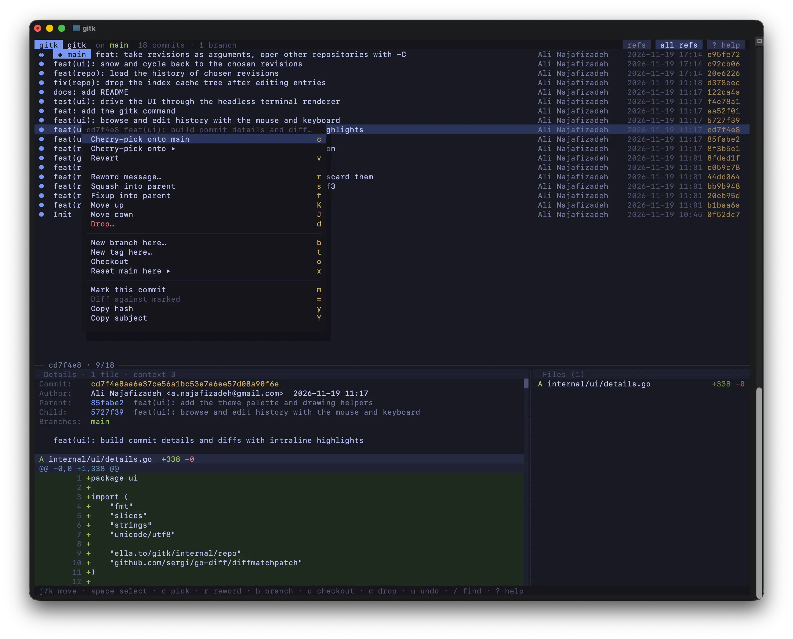

# gitk (terminal)

A terminal take on `gitk --all`: browse the commit graph, read diffs, and
rewrite history (cherry-pick, reword, squash, reorder, drop) with the mouse
or the keyboard, with undo for every change.

## Highlights

* **The whole graph at a glance**: colored branch lanes, ref badges, and your
  uncommitted changes as rows on top, just like gitk.
* **Readable diffs**: line numbers, word-level highlights, adjustable context,
  and a file list that follows you as you scroll.
* **History editing without the ceremony**: drag commits onto a branch to
  cherry-pick them, reword any commit on a local branch, squash, move and
  drop commits. Every operation can be undone with `u`.
* **Safe by default**: conflicts abort without changing anything, and your
  unrelated local edits are never touched.
* **No `git` binary needed**: everything runs in-process on
  [go-git](https://github.com/go-git/go-git); the UI is built with
  [ella.to/microui](https://ella.to/microui).
* **Live**: the view reloads by itself when the repository changes on disk.

## Install

```sh
go install ella.to/gitk@latest
```

## Usage

```sh
gitk                     # every branch, remote and tag (like gitk --all)
gitk main v1.2 3f9c2a1   # only the history of these branches, tags and commits
gitk -C ~/src/project    # a repository other than the current directory's
gitk -head               # only HEAD's history
gitk -relative           # "3 hours ago" dates (toggle with T)
gitk -light              # light theme (toggle with L)
```

Press `?` inside gitk for the full list of keys, and `a` to cycle between all
refs, HEAD only, and the revisions given on the command line.

## Layout



* **Commit list**: one row per commit with lanes drawn in rounded box
  characters, ref badges (HEAD branch `◆`, local, remote, tags `⚑`), author,
  date and hash. Uncommitted and staged changes appear as rows on top, like
  gitk.
* **Details**: author, committer, clickable parents and children, branches
  containing the commit, nearest tags before (`Follows`) and after
  (`Precedes`), the message, then a colored unified diff with old/new line
  numbers and word-level highlights of what changed in each line.
* **Files**: the changed files with `+/−` counts; it follows the diff as you
  scroll, and clicking a file jumps to it.
* **Refs sidebar** (`\`): branches, remotes and tags; click to jump,
  double-click to check out.

Drag the separators to resize panes. The view reloads by itself when the
repository changes on disk (a commit or checkout from another terminal).

## Editing history

Every operation runs in-process on go-git, shows a confirmation where it
matters, and can be undone with `u` (and redone with `U`):

| | keys | mouse |
|---|---|---|
| Cherry-pick onto HEAD | `c` (applies the whole multi-selection, oldest first) | context menu |
| Cherry-pick onto another branch | context menu ▸ *Cherry-pick onto* | **drag commits onto a branch** (a badge in the list or the refs sidebar) |
| Reword a commit message (any commit on a local branch) | `r` | context menu |
| Revert | `v` | context menu |
| Squash / fixup into parent | `s` / `f` | context menu |
| Move a commit up / down | `K` / `J` | context menu |
| Drop a commit | `d` | context menu |
| New branch / tag here | `b` / `t` | context menu |
| Checkout | `o` | double-click a branch badge |
| Reset the current branch here (keep, soft, mixed, hard) | `x` | context menu |
| Rename / delete a branch, delete a tag | `R` / `D` in the refs sidebar | right-click a badge |
| Stage / unstage a file, everything | `space` / `S` | double-click a file |
| Discard a file's changes | `D` | right-click a file |
| Commit / amend | `C` / `A` | context menu on the local-changes rows |

Multi-select with `space`, ctrl-click or shift-click (and shift+↑/↓).

How the edits work:

* **Reword** and **squash** rewrite the commit and every descendant on the
  local branches that contain it, keeping all trees unchanged, so they never
  conflict and never touch your working tree. Branches that share the
  rewritten history keep sharing it.
* **Cherry-pick**, **revert**, **drop** and **move** replay changes with a
  built-in three-way merge (tree-level, then line-level diff3). A conflict
  aborts the operation without changing anything and names the files.
  Commits whose change is already present are skipped.
* Operations that move the checked-out branch update only the files that
  differ, and refuse if any of those files has local changes, like
  `git checkout` does. Unrelated local edits are left alone.
* Rewritten commits lose GPG/SSH signatures; the details pane says when a
  commit is signed.

## Other keys

| keys | |
|---|---|
| `j` `k` `↑` `↓` `PgUp` `PgDn` `g` `G` | move |
| `Tab` | next pane (commits → details → files) |
| `Enter` | open the diff / jump to the file |
| `←` `→` | back / forward through jumps (in the diff: pan horizontally) |
| `p` | jump to the first parent |
| `/` `n` `N` | find (message, author, hash prefix, ref name; smart case) |
| `m` then `=` | mark a commit, then diff any selection against it |
| `[` `]` | less / more diff context |
| `,` `.` | previous / next file in the diff |
| `y` `Y` | copy hash (or file path) / subject (pbcopy, wl-copy, xclip or OSC 52) |
| `a` | all refs → HEAD only → the revisions given on the command line |
| `R` | reload |
| `?` | help |
| `q` | quit |

## Development

```sh
go test ./...
GITK_REPO=/path/to/big/repo SHOW=1 go test ./internal/ui -run RealRepo -v  # timings and a rendered frame
```

* `internal/repo`: loading, diffs, status, the merge engine and every
  operation as an undoable `Op` (tests validate results with `git fsck` when
  git is installed).
* `internal/graph`: lane layout, one row per commit.
* `internal/ui`: the microui interface; tests drive it through microui's
  headless terminal renderer.
